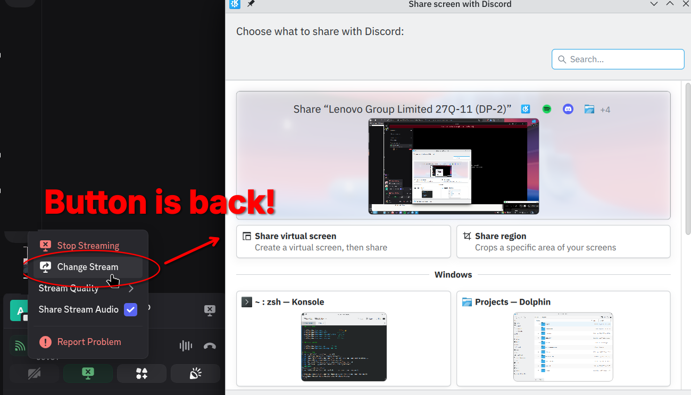
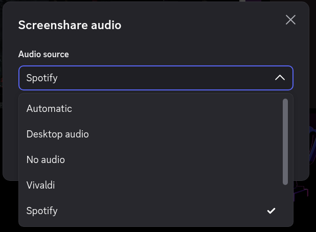

# Equicord Screenshare

Share application audio and switch windows without restarting your Discord stream.





## Install

Open a terminal and paste:

```bash
curl -fsSL https://raw.githubusercontent.com/aliveoutside/equicord-screenshare/main/setup.sh | bash
```

**Using the AUR `equicord` package?** Its launcher restores the packaged `app.asar` and `equicord.asar`, overwriting an injected screenshare build. This installer rejects that conflict. To keep the AUR installation, add the plugin to its Equicord source checkout and compile the native module before the package's `pnpm buildStandalone` step. Otherwise, use a separate official Discord installation and select its configuration directory with `--discord`.

**Already using Equicord injected into official Discord?** This installer replaces the build Discord loads with Equicord plus this plugin. You no longer need to build or update your old copy separately. Use the update command below from now on.

When it finishes, **restart discord**.

The installer supports Arch/CachyOS, Debian/Ubuntu and Fedora on x64. Flatpak and Snap installs aren't supported. This installs Equicord and replaces any existing Discord mod installation.

For a custom configuration directory:

```bash
curl -fsSL https://raw.githubusercontent.com/aliveoutside/equicord-screenshare/main/setup.sh | bash -s -- --discord /path/to/config
```

Later commands reuse that directory unless you pass `--discord` again.

## Manual install

For your own Equicord fork, use Node 22+ with development headers and the pnpm version your fork requires. Install the native build dependencies:

Arch/CachyOS:

```bash
sudo pacman -S --needed gcc make pkgconf glib2 pipewire libpulse
```

Debian/Ubuntu:

```bash
sudo apt update
sudo apt install build-essential pkg-config libglib2.0-dev libpipewire-0.3-dev libpulse-dev
```

Fedora:

```bash
sudo dnf install gcc-c++ make pkgconf-pkg-config glib2-devel pipewire-devel pulseaudio-libs-devel
```

Official Node downloads include development headers. For distro Node, install `libnode-dev` on Debian/Ubuntu or `nodejs-devel` on Fedora; Arch includes them with `nodejs`.

Run from your fork's root:

```bash
git clone https://github.com/aliveoutside/equicord-screenshare.git src/userplugins/waylandScreenshare
pnpm install --frozen-lockfile
node src/userplugins/waylandScreenshare/build.mjs
pnpm build
pnpm inject
```

Restart Discord afterward. To update, pull the plugin repository and repeat the build steps.

## Update

```bash
equicord-screenshare update
```

Restart Discord afterward.

## Uninstall

```bash
equicord-screenshare uninstall
```

Removes Equicord from Discord. Downloaded files stay so you can reinstall later.

## OpenAsar

Optional, using the official Equicord installer:

```bash
equicord-screenshare install-openasar
equicord-screenshare uninstall-openasar
```

## Use

Start a screenshare with **Sound** enabled. Audio is selected automatically when your app or monitor is recognized. Otherwise, the picker opens so you can select an application or desktop audio


Highly experimental.

GPL-3.0-or-later. See [LICENSE](LICENSE).
